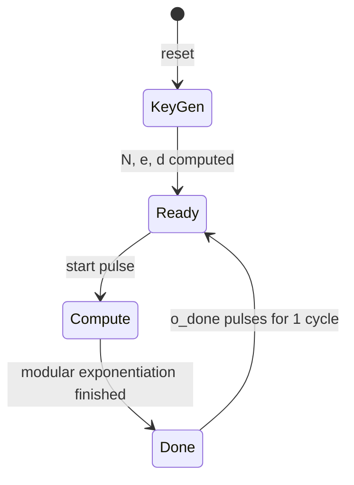
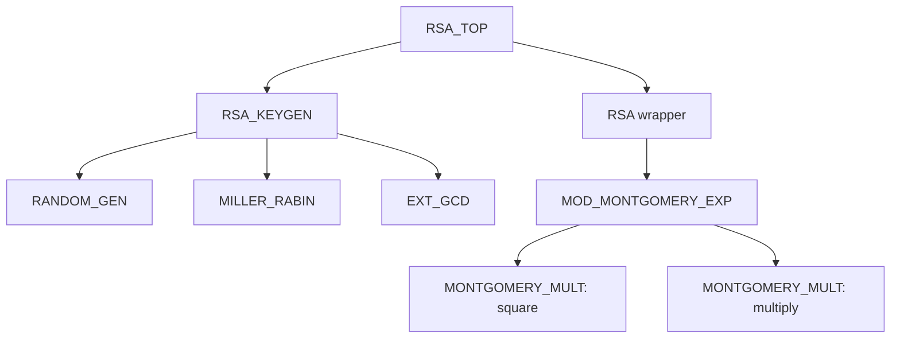

# Hardware RSA Cryptoprocessor in VHDL

A VHDL implementation of an RSA cryptographic coprocessor built from synchronous, iterative RTL blocks. A single top-level design covers key generation, modular arithmetic, encryption and decryption.

It is an **educational hardware-design project**: the source and testbench show how a public-key algorithm can be decomposed into RTL modules and coordinated with finite-state machines (FSMs).

## Table of contents

1. [Features](#features)
2. [RSA in a nutshell](#rsa-in-a-nutshell)
3. [How it works](#how-it-works)
4. [Architecture](#architecture)
5. [Design parameters](#design-parameters)
6. [Interface](#interface)
7. [Quick start](#quick-start)
8. [Verification](#verification)
9. [Performance estimates](#performance-estimates)
10. [Repository structure](#repository-structure)
11. [Limitations](#limitations)
12. [Concepts demonstrated](#concepts-demonstrated)

## Features

- On-chip key generation: pseudo-random prime candidates, Miller-Rabin testing, modulus and totient calculation
- Private exponent derivation with the extended Euclidean algorithm
- Encryption and decryption through one shared modular-exponentiation datapath
- Bit-serial Montgomery multiplication, so no large combinational multipliers or dividers
- Default 1024-bit modulus (two 512-bit primes), parameterized in `RSA_PKG`
- Self-checking testbench that verifies the encrypt-then-decrypt round trip

## RSA in a nutshell

Two primes, $p$ and $q$, produce a key pair.

**Key generation**

| Value | Definition |
|---|---|
| Modulus | $N = p \times q$ |
| Totient | $\varphi(N) = (p-1)(q-1)$ |
| Public exponent | $e = 65537$ (fixed) |
| Private exponent | $d = e^{-1} \bmod \varphi(N)$ |

The public key is $(N, e)$ and the private key is $(N, d)$.

**Encryption** of a message $m$ with $0 \le m < N$:

$$c = m^e \bmod N$$

**Decryption:**

$$m' = c^d \bmod N$$

For a valid key pair and input, $m' = m$. The testbench checks exactly this property.

## How it works

`RSA_TOP` generates keys after reset, then waits for requests.



1. **Reset / start-up:** the controller begins key generation.
2. **Key generation:** candidate primes are generated and tested, then $N$ and $d$ are computed.
3. **Ready:** the controller waits for `start`.
4. **Operation select:** `mode = '0'` encrypts, `mode = '1'` decrypts.
5. **Calculation:** the `RSA` wrapper launches modular exponentiation.
6. **Completion:** `o_result` holds the result and `o_done` pulses for one clock cycle.

Encryption and decryption share the same hardware and differ only in the exponent.

## Architecture

Each major mathematical operation has its own RTL module.

| File | Entity | Responsibility |
|---|---|---|
| `RSA_PKG.vhd` | `RSA_PKG` | Shared constants, widths and helper functions |
| `RSA_TOP.vhd` | `RSA_TOP` | Top-level controller and external interface |
| `RSA_KEYGEN.vhd` | `RSA_KEYGEN` | Coordinates prime generation, primality testing and private-key calculation |
| `RANDOM_GEN.vhd` | `RANDOM_GEN` | Pseudo-random candidates from a 128-bit LFSR |
| `MILLER_RABIN.vhd` | `MILLER_RABIN` | Probable-primality testing |
| `EXT_GCD.vhd` | `EXT_GCD` | Modular inverse for the private exponent |
| `RSA.vhd` | `RSA` | Prepares the message and starts modular exponentiation |
| `MOD_MONTGOMERY_EXP.vhd` | `MOD_MONTGOMERY_EXP` | Square-and-multiply modular exponentiation |
| `MONTGOMERY_MULT.vhd` | `MONTGOMERY_MULT` | Iterative Montgomery modular multiplication |
| `TB_RSA_TOP.vhd` | `TB_RSA_TOP` | Top-level round-trip testbench |



> This hierarchy is drawn from the project report. Verify it against the source if you modify the design.

### Montgomery multiplication

Modular exponentiation needs many modular multiplications, and division-based reduction is costly in hardware. The design uses a bit-serial Montgomery multiplier that processes one operand bit per clock cycle. Each step conditionally adds the operands, adjusts the accumulator so it can be shifted, and a final modular correction completes the result. For a $K$-bit operand, latency is about $K + 2$ cycles.

### Modular exponentiation

`MOD_MONTGOMERY_EXP` uses a least-significant-bit-first square-and-multiply method: it converts operands into the Montgomery domain, iterates over the exponent bits, then converts the result back. Two multipliers are instantiated, one for squaring and one for the conditional multiply, so the two operations can overlap where control flow allows.

## Design parameters

| Parameter | Default | Meaning |
|---|---|---|
| `PRIME_WIDTH` | 512 bits | Width of each prime candidate ($p$, $q$) |
| `KEY_WIDTH` | 1024 bits | Width of the modulus and main operands (twice `PRIME_WIDTH`) |
| `NUM_WITNESSES` | 4 | Miller-Rabin witnesses used |
| Public exponent `e` | 65537 | Fixed |
| LFSR seed width | 128 bits | Pseudo-random generator seed |

If you change a width, keep `KEY_WIDTH = 2 * PRIME_WIDTH` and confirm the values in `RSA_PKG.vhd`.

## Interface

Top-level entity `RSA_TOP`:

| Signal | Dir | Description |
|---|---|---|
| `clk` | in | System clock |
| `rst` | in | Active-high asynchronous reset; restarts key generation |
| `i_message` | in | Message to encrypt, or ciphertext to decrypt |
| `mode` | in | `'0'` = encrypt, `'1'` = decrypt |
| `start` | in | Pulse to request an operation |
| `o_done` | out | High for one cycle when the result is ready |
| `o_result` | out | Result of encryption or decryption |
| `o_N` | out | RSA modulus (debug) |
| `o_e` | out | Public exponent (debug) |
| `o_d` | out | Private exponent (debug) |

Keys are generated after every reset, so only assert `start` once key generation has finished and the design is ready.

## Quick start

You need a VHDL simulator such as GHDL, Questa/ModelSim or Vivado Simulator. The report does not name a final tool, so the commands below are an **unverified GHDL example**. Adjust paths and the language standard to match your setup.

```bash
# Compile RSA_PKG first; other units depend on it
ghdl -a --std=08 RSA_PKG.vhd
ghdl -a --std=08 hdl/MONTGOMERY_MULT.vhd
ghdl -a --std=08 hdl/MOD_MONTGOMERY_EXP.vhd
ghdl -a --std=08 hdl/RSA.vhd
ghdl -a --std=08 hdl/RANDOM_GEN.vhd
ghdl -a --std=08 hdl/MILLER_RABIN.vhd
ghdl -a --std=08 hdl/EXT_GCD.vhd
ghdl -a --std=08 hdl/RSA_KEYGEN.vhd
ghdl -a --std=08 hdl/RSA_TOP.vhd
ghdl -a --std=08 hdl/TB_RSA_TOP.vhd

# Elaborate and run
ghdl -e --std=08 TB_RSA_TOP
ghdl -r --std=08 TB_RSA_TOP --wave=rsa_top.ghw
```

In any simulator the flow is the same: compile `RSA_PKG.vhd` first, then the RTL in dependency order, then the testbench; set `TB_RSA_TOP` as the top level and check the assertions and waveforms.

Key generation with 512-bit primes can take a long time in RTL simulation, since the number of rejected candidates varies. Be prepared for long runtimes.

> `Test.vhd` also appears in the repository. The report names `TB_RSA_TOP.vhd` as the main round-trip testbench, so check `Test.vhd` before relying on it.

## Verification

`TB_RSA_TOP` encrypts each test message, decrypts the ciphertext, and asserts that the recovered value equals the original.

| Message $m$ | Check | Reported status |
|---|---|---|
| 42 | Decryption recovers 42 | PASS |
| 99 | Decryption recovers 99 | PASS |
| 12345 | Decryption recovers 12345 | PASS |

Simulation setup: clock period 10 ns (100 MHz).

<!-- Waveforms: add screenshots to documents/images/ and uncomment, e.g.


GitHub paths are case-sensitive. -->

## Performance estimates

Analytical figures from the project report for a 1024-bit modulus at 100 MHz. They are **not** measured results from synthesis or place-and-route.

| Operation | Approx. cycles | Approx. time |
|---|---|---|
| Key generation | Variable | Depends on how many candidates are rejected |
| Encryption ($e = 65537$) | ~40,000 | ~0.4 ms |
| Decryption (dense $d$) | ~2,100,000 | ~21 ms |
| Worst-case modular exponentiation | ~2,097,152 | ~21 ms |

Encryption is far faster because 65537 ($2^{16}+1$) has only two set bits, so the conditional multiply runs rarely. A typical private exponent has many set bits.

## Repository structure

Based on the report; your layout may differ.

```text
RSA-IMPLEMENTATION-HDL/
├── RSA_PKG.vhd
├── Test.vhd
├── hdl/
│   ├── RSA_TOP.vhd
│   ├── RSA_KEYGEN.vhd
│   ├── RANDOM_GEN.vhd
│   ├── MILLER_RABIN.vhd
│   ├── EXT_GCD.vhd
│   ├── RSA.vhd
│   ├── MOD_MONTGOMERY_EXP.vhd
│   ├── MONTGOMERY_MULT.vhd
│   └── TB_RSA_TOP.vhd
└── documents/
    └── project report and supporting documentation
```

## Limitations

- **Educational only:** not a production cryptographic module.
- **No padding:** textbook RSA; real systems need a standardized scheme such as OAEP.
- **Predictable randomness:** an LFSR is not a cryptographically secure source of prime candidates.
- **Weak primality testing:** fixed witnesses `{2, 3, 5, 7}` do not guarantee primality for arbitrary 512-bit numbers.
- **No hardware results:** no FPGA resource usage, post-route Fmax or board bring-up data.
- **Simulator unconfirmed:** no verified compile script or tool version yet.

## Concepts demonstrated

- VHDL RTL design and modular hardware architecture
- FSMs and handshake signals
- Parameterized datapaths for large operands
- Iterative, bit-serial arithmetic
- Montgomery modular multiplication
- Square-and-multiply exponentiation
- Prime generation and Miller-Rabin testing
- Extended Euclidean algorithm for modular inverses
- Testbench-driven simulation with round-trip assertions

## Contributing

Reproducibility improvements are especially welcome: a verified compile script, the exact simulator version, waveform screenshots, and synthesis results for a target FPGA.
